> Convertido desde `docs/originales/inventario-pantallas.docx`. A partir de ahora, esta versión en Markdown es la canónica.

**Inventario de pantallas y campos — ERP Trabajo Temporal / ETT**

Documento generado a partir de 47 fotografías del software. Los tipos de campo son inferidos visualmente; no se ha accedido a la base de datos ni al código de la aplicación.

Nota de privacidad: se documentan nombres de campos y tipos, evitando transcribir valores personales visibles en las capturas de candidatos/trabajadores.

## Resumen de pantallas identificadas

1. Empresa de nómina — Dirección

2. Cliente — Identificación

3. Cliente — Facturación

4. Cliente — Firma Digital/Web

5. Cliente — Centros

6. Cliente — Contactos

7. Usuario Portal del Cliente

8. Oferta — Datos Oferta

9. Oferta — Datos de Cálculo

10. Oferta — Detalles y líneas de precio

11. Tabla auxiliar — Tipos de Contrato

12. Tabla auxiliar — Categorías TTI-SRV

13. Ofertas — Consulta y generación de petición

14. Peticiones ETT — Consulta/Listado

15. Nueva Petición ETT — Datos contrato

16. Nueva Petición ETT — Características / Selección

17. Nueva Petición ETT — Oferta WEB

18. Nueva Petición ETT — Precios Nómina

19. Asignaciones de Peticiones de ETT

20. Candidatos — Búsqueda/Listado

21. Documento impreso/PDF de oferta o contrato

## 1. Empresa de nómina — Dirección

Ficha de empresa de nómina con pestañas Dirección, Actividad, Laboral, Winsuite/Factura, Ofertas, Contactos, E.R.E y Fijos Discontinuos.

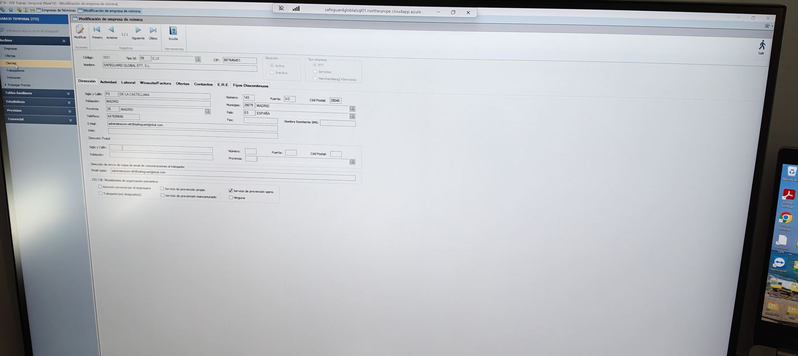

Captura de referencia: IMG20260626173235.jpg

| Campo / control visible | Tipo inferido | Observaciones |
|---|---|---|
| Código | Numérico / código | Identificador interno. |
| Tipo Id | Selector + búsqueda | Ej. CIF/DNI u otro tipo de identificación. |
| CIF | Texto fiscal | Documento fiscal. |
| Nombre | Texto | Razón social. |
| Situación | Radio | Activa / Inactiva. |
| Tipo empresa | Radio | ETT / Servicios / Merchandising (+Servicios). |
| Sigla y calle, número, puerta, código postal | Texto / numérico | Dirección fiscal. |
| Población, municipio, provincia, país | Texto + búsqueda | Campos geográficos con selector. |
| Teléfono, fax, e-mail, web | Teléfono / e-mail / URL | Datos de contacto. |
| Dirección postal | Bloque de dirección | Dirección alternativa. |
| E-mail copia comunicaciones trabajador | E-mail | Remitente/copias. |
| Modalidades organización preventiva | Checkbox múltiple | Asunción propia, trabajador designado, servicio propio, mancomunado, ajeno, ninguno. |

## 2. Cliente — Identificación

Alta/consulta de cliente con datos generales, comerciales y de contacto.

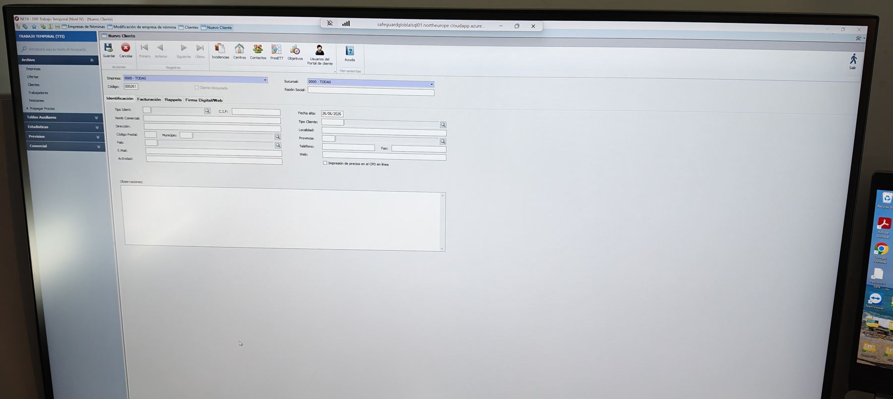

Captura de referencia: IMG20260626173243.jpg

| Campo / control visible | Tipo inferido | Observaciones |
|---|---|---|
| Empresa / Sucursal | Selector desplegable | Ámbito del cliente. |
| Código | Numérico / código | Identificador del cliente. |
| Cliente bloqueado | Checkbox | Bloqueo operativo. |
| Razón social | Texto | Nombre legal. |
| Tipo Ident. | Selector + búsqueda | Tipo de documento. |
| C.I.F. | Texto fiscal | Identificación fiscal. |
| Nombre comercial | Texto | Nombre de uso comercial. |
| Dirección | Texto | Dirección principal. |
| Código postal / municipio / país / provincia / localidad | Texto + búsqueda | Ubicación. |
| Teléfono / fax / e-mail / web | Teléfono / e-mail / URL | Contacto. |
| Actividad | Texto | Actividad del cliente. |
| Fecha alta | Fecha | Alta del cliente. |
| Tipo cliente | Selector + búsqueda | Clasificación de cliente. |
| Impresión de precios en CPD en línea | Checkbox | Control de impresión/portal. |
| Observaciones | Área de texto | Notas libres. |

## 3. Cliente — Facturación

Pestaña de facturación del cliente con datos bancarios, condiciones de factura y parámetros de retención/IVA.

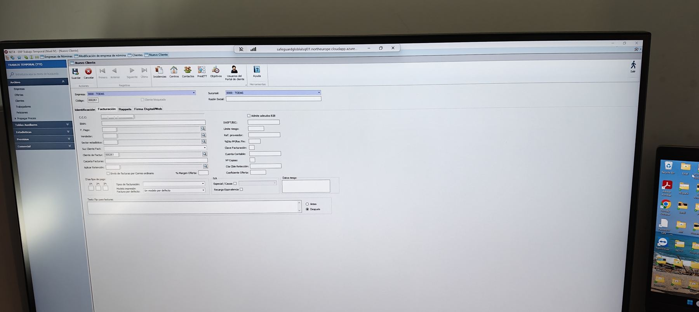

Captura de referencia: IMG20260626173246.jpg

| Campo / control visible | Tipo inferido | Observaciones |
|---|---|---|
| C.C.C. / IBAN / SWIFT-BIC | Texto bancario | Datos de cuenta. |
| F. pago | Selector + búsqueda | Forma de pago. |
| Vendedor / sector estadístico | Código + búsqueda | Asignación comercial/analítica. |
| Sub cliente fact. / cliente de facturar | Selector / código | Entidad de facturación. |
| Carpeta facturas | Ruta / texto | Archivo documental. |
| Aplicar retención | Selector + búsqueda | Parámetro fiscal. |
| Admite adeudos B2B | Checkbox | Adeudos directos. |
| Límite riesgo | Importe | Riesgo permitido. |
| Ref. proveedor / NDto PP Rec.Fin | Texto / código | Referencia proveedor y campos financieros. |
| Clave facturación / cuenta contable | Código | Contabilidad. |
| Nº copias / cta. cliente retención / coeficiente oferta | Numérico / decimal | Impresión y cálculo. |
| Días fijo de pago | Día numérico múltiple | Tres casillas visibles. |
| Tipos de facturación / modelo impresión factura por defecto | Selector | Opciones de emisión. |
| IVA especial/causa, recargo equivalencia | Selector + checkbox | Parámetros fiscales. |
| Datos riesgo | Área de texto | Notas de riesgo. |
| Texto fijo para facturas | Área de texto + posición | Antes / Después. |

## 4. Cliente — Firma Digital/Web

Configuración de firma digital para facturas, CPDs y acceso web.

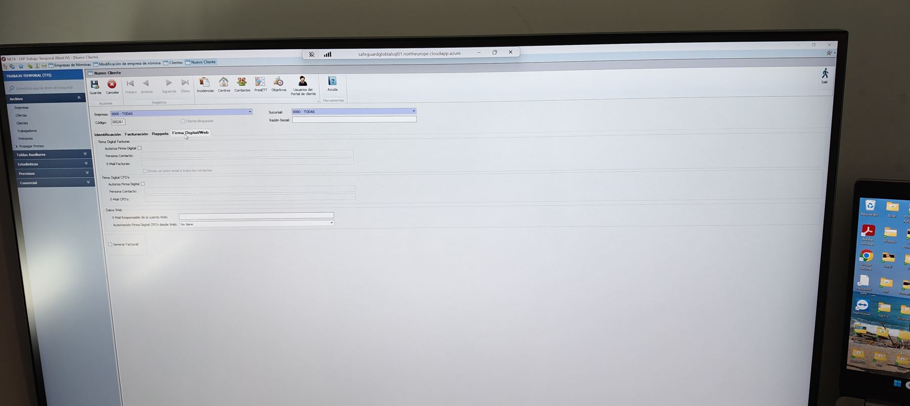

Captura de referencia: IMG20260626173250.jpg

| Campo / control visible | Tipo inferido | Observaciones |
|---|---|---|
| Autoriza firma digital | Checkbox | Bloques Facturas y CPDs. |
| Persona contacto | Texto | Contacto autorizado. |
| E-mail facturas / E-mail CPDs | E-mail | Direcciones de envío. |
| Enviar un único e-mail a todos los contactos | Checkbox | Opción de comunicación. |
| E-mail responsable cuenta web | E-mail | Usuario/responsable web. |
| Autorización firma digital CPDs desde Web | Selector | Estado de autorización. |
| Generar factura E. | Checkbox | Factura electrónica. |

## 5. Cliente — Centros

Alta/modificación de centros asociados a un cliente: ubicación, convenios y datos laborales.

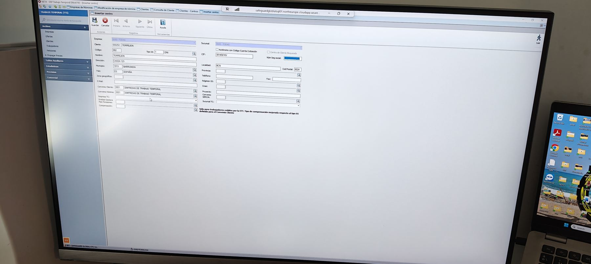

Captura de referencia: IMG20260626173351.jpg

| Campo / control visible | Tipo inferido | Observaciones |
|---|---|---|
| Cliente / código centro / tipo Id / CIF | Código + selector | Identificación del centro. |
| Autónomo con código cuenta cotización | Checkbox | Centro con CCC propio. |
| Centro de cliente bloqueado | Checkbox | Bloqueo del centro. |
| Número Seguridad Social | Texto / numérico | Núm. Seg. Social. |
| Nombre / dirección / municipio / localidad / provincia / país / CP / zona geográfica | Texto + búsqueda | Datos de ubicación. |
| Teléfono / fax / e-mail | Contacto | Datos contacto. |
| Régimen SS / CNAE | Código + búsqueda | Clasificación laboral. |
| Convenio cliente / convenio nómina | Código + búsqueda | Convenios aplicables. |
| Proyecto / convenio GRDA / sucursal TC | Código / selector | Parámetros operativos. |
| Empresa TC / entidad gestores / plan pensiones / compensación | Código / selector | Campos laborales y de compensación. |

## 6. Cliente — Contactos

Gestión de contactos del cliente/centro, con listado y ficha individual.

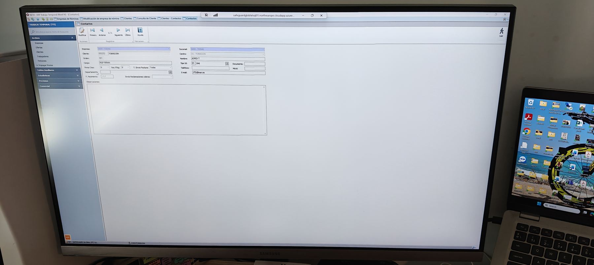

Captura de referencia: IMG20260626173420.jpg

| Campo / control visible | Tipo inferido | Observaciones |
|---|---|---|
| Empresa / sucursal / cliente / centro | Selector / código | Contexto del contacto. |
| Orden | Numérico | Prioridad. |
| Nombre | Texto | Nombre del contacto. |
| Cargo | Texto | Puesto. |
| Firma CPDs / Rec. FDig | Selector Sí/No | Permisos de firma/recepción. |
| Tipo envío factura | Selector | Todas u otra opción. |
| Departamento | Texto | Área interna. |
| Fecha nacimiento | Fecha | Dato opcional. |
| Envía reclamaciones cobro | Selector | Comunicación cobros. |
| Tipo Id / documento | Selector + texto | Identificación personal. |
| Teléfono / móvil / e-mail | Contacto | Datos de contacto. |
| Observaciones | Área de texto | Notas. |
| Listado de contactos | Tabla | Columnas: orden, nombre, cargo, documento, firma, teléfono, e-mail, código, departamento, fecha nacimiento, observaciones. |

## 7. Usuario Portal del Cliente

Alta de usuario del portal cliente con credenciales y permisos de menú.

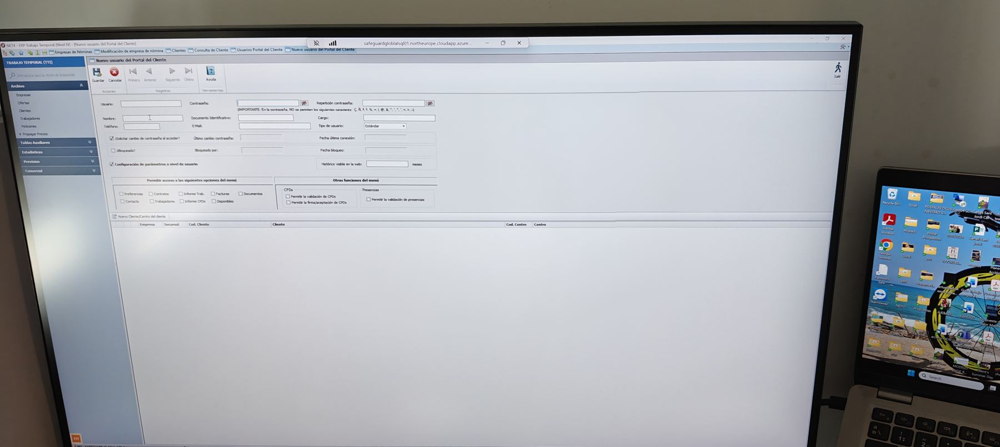

Captura de referencia: IMG20260626173441.jpg

| Campo / control visible | Tipo inferido | Observaciones |
|---|---|---|
| Usuario | Texto | Login. |
| Contraseña / repetición contraseña | Contraseña | Campos enmascarados. |
| Nombre / teléfono / e-mail | Texto / contacto | Datos del usuario. |
| Documento identificación / cargo | Texto | Perfil de usuario. |
| Tipo de usuario | Selector | Ej. estándar. |
| Solicitar cambio de contraseña al acceder | Checkbox | Control de seguridad. |
| Último cambio contraseña / fecha último acceso | Fecha | Auditoría. |
| Bloqueado / bloqueado por / fecha bloqueo | Checkbox + texto + fecha | Gestión de bloqueo. |
| Histórico visible en web | Numérico + unidad | Meses visibles. |
| Opciones de menú | Checkbox múltiple | Preferencias, contratos, informes trabajador, facturas, documentos, contactos, trabajadores, informe CPDs, disponibles. |
| Funciones CPDs / presencias | Checkbox múltiple | Permite validación/finalización CPDs y validación de presencias. |
| Centros asociados | Tabla | Empresa, sucursal, código cliente, cliente, código centro y centro. |

## 8. Oferta — Datos Oferta

Ficha principal de nueva oferta del cliente: cabecera, condiciones, convenio y observaciones.

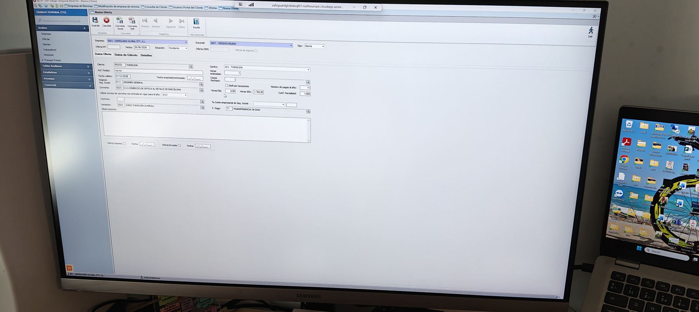

Captura de referencia: IMG20260626173535.jpg

| Campo / control visible | Tipo inferido | Observaciones |
|---|---|---|
| Empresa / sucursal / tipo | Selector | Ámbito de la oferta. |
| Oferta Nº / fecha / situación / oferta CRM | Numérico + fecha + selector | Cabecera. |
| Oferta de agraria | Checkbox | Marca específica. |
| Cliente / referencia pedido | Código + búsqueda / texto | Cliente y referencia. |
| Fecha válida / fecha aceptada-rechazada | Fecha | Vigencia y aceptación. |
| Régimen Seg. Social / convenio | Código + búsqueda | Parámetros laborales. |
| Usar precios de convenio con entrada en vigor para el año | Selector año | Año de referencia. |
| Categoría / vendedor | Código + búsqueda | Perfil y comercial. |
| Centro / horas estimadas / causa rechazo | Selector + numérico + búsqueda | Condiciones. |
| Disfruta vacaciones | Checkbox | Vacaciones. |
| Número de pagas al año / horas día / horas año / coef. parcialidad | Numérico / decimal | Cálculo laboral. |
| % coste empresarial Seg. Social / forma de pago | Porcentaje / selector | Cálculo y pago. |
| Observaciones | Área de texto | Notas. |
| Oferta impresa / oferta enviada + fechas | Checkbox + fecha | Control documental. |

## 9. Oferta — Datos de Cálculo

Pestaña de importes y conceptos de cálculo de oferta.

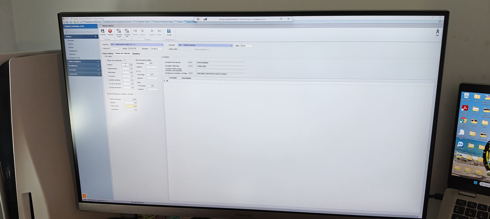

Captura de referencia: IMG20260626173559.jpg

| Campo / control visible | Tipo inferido | Observaciones |
|---|---|---|
| Cálculo de coeficientes | Grupo numérico | Margen, indemnización, absentismo, formación, etc. |
| Reconocimientos médicos | Porcentaje / importe | Coste médico. |
| Conceptos Hora Normal / Tarifa Mes / Tarifa empresa corta duración / Recargo contratos <30 días | Código + descripción | Conceptos aplicados. |
| Concepto / descripción | Tabla editable | Líneas de conceptos. |
| Importe recargo contratos <30 días | Importe / margen / tarifa venta / coeficiente | Cálculo adicional. |

## 10. Oferta — Detalles y líneas de precio

Pestaña Detalles con puesto, salario, tarifas, coeficientes e impresión de conceptos.

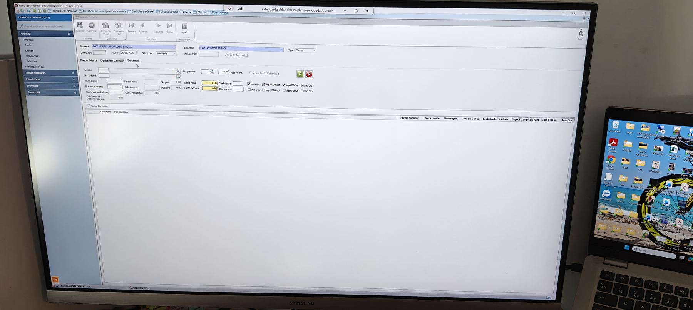

Captura de referencia: IMG20260626173624.jpg

| Campo / control visible | Tipo inferido | Observaciones |
|---|---|---|
| Puesto / ocupación | Código + búsqueda | Puesto ofertado. |
| Nivel salarial / bruto anual / bruto mes / salario hora / salario mes | Código + importes | Retribución. |
| Margen / % IT + IMS | Porcentaje | Margen y recargos. |
| Tarifa horas / tarifa mensual / coeficiente | Importe + decimal | Precio de venta. |
| Aplica bonif. maternidad | Checkbox | Bonificación. |
| Impresión oferta / CPD factura / CPD salario / Ctb | Checkbox múltiple | Visibilidad/impresión por concepto. |
| Nuevo concepto | Acción | Añadir línea. |
| Tabla de conceptos | Tabla | Concepto, descripción, precio nómina, precio coste, % margen, precio venta, coeficiente, otros e indicadores de impresión. |

## 11. Tabla auxiliar — Tipos de Contrato

Listado de tipos de contrato usados para parametrizar ofertas/peticiones.

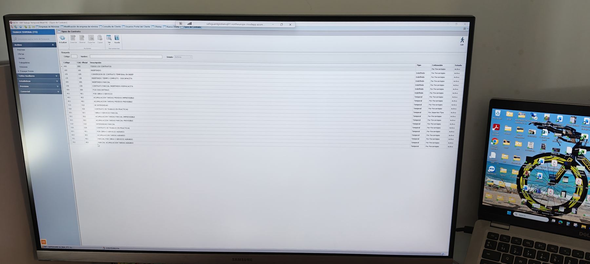

Captura de referencia: IMG20260626173541.jpg

| Campo / control visible | Tipo inferido | Observaciones |
|---|---|---|
| Código / nombre / estado | Filtros de búsqueda | Estado activo visible. |
| Actualizar / imprimir / exportar / ver | Acciones | Botonera superior. |
| Código / código oficial / descripción | Columnas tabla | Identificación del contrato. |
| Tipo / cotización / estado | Columnas tabla | Ej. temporal/indefinido, por porcentajes, activo. |

## 12. Tabla auxiliar — Categorías TTI-SRV

Listado de categorías/puestos con filtros por ocupación, convenio y clasificación.

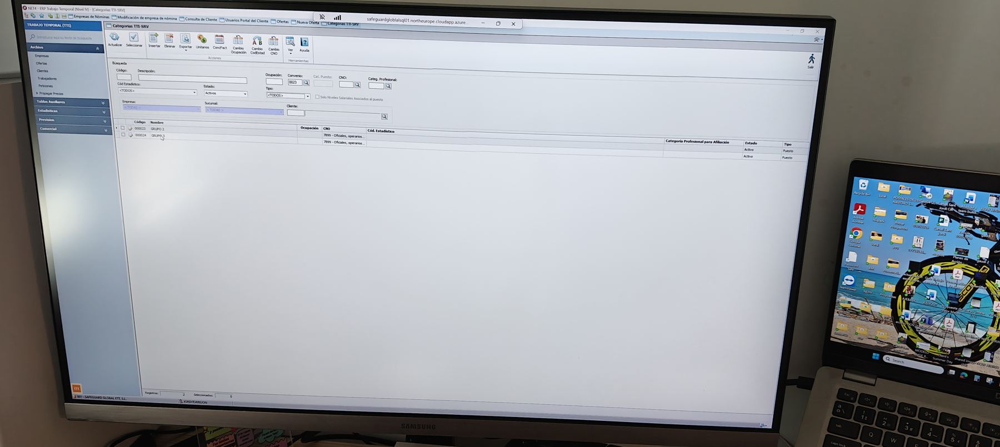

Captura de referencia: IMG20260626173633.jpg

| Campo / control visible | Tipo inferido | Observaciones |
|---|---|---|
| Código / descripción / código estadístico / estado / tipo | Filtros | Búsqueda por categoría. |
| Ocupación / convenio / categoría profesional / CNO | Código + búsqueda | Clasificación profesional. |
| Empresa / sucursal / cliente | Selector / código | Ámbito. |
| Código / nombre / ocupación / CNO / cód. estadístico | Columnas tabla | Resultados. |
| Categoría profesional para afiliación / estado / tipo | Columnas tabla | Parámetros de afiliación. |

## 13. Ofertas — Consulta y generación de petición

Listado de ofertas con filtros y ventana modal para aceptar/generar petición.

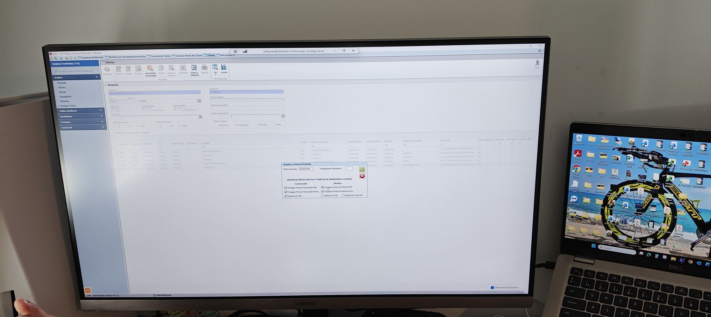

Captura de referencia: IMG20260626173951.jpg

| Campo / control visible | Tipo inferido | Observaciones |
|---|---|---|
| Empresa / sucursal / centro cliente | Selector | Ámbito de búsqueda. |
| Tipo / cliente / oferta / referencia pedido | Filtros | Localización de oferta. |
| Fecha alta / fecha válida / grupo empresarial | Fecha + código | Filtros temporales y grupo. |
| Cliente / convenio / categoría / puesto | Código + búsqueda | Filtros de contenido. |
| Ofertas impresas / enviadas / inscritas | Radio / selector | Estado de publicación. |
| Estado oferta | Radio | Aceptadas / pendientes / otras. |
| Tabla de ofertas | Tabla | Columnas visibles: empresa, sucursal, cliente, centro, fechas, estado, referencia pedido, convenio, tipo contrato, empresa/convenio/oferta CPD. |
| Fecha situación | Fecha | Modal de aceptación/generación. |
| Trabajadores solicitados | Numérico | Modal. |
| Propagación de precios y marcas de impresión | Checkbox múltiple | Factura y nómina: propagar precios, imprimir CPD, imprimir en contrato. |

## 14. Peticiones ETT — Consulta/Listado

Listado de peticiones de ETT con filtros por cliente, oferta, fechas, puesto y estado.

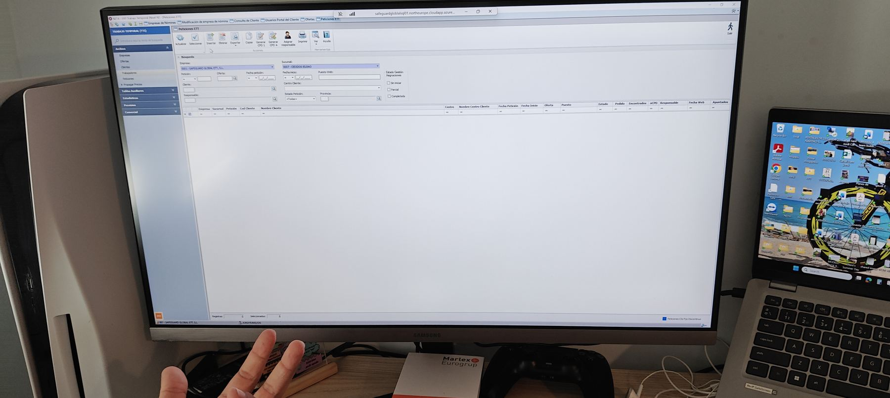

Captura de referencia: IMG20260626173935.jpg

| Campo / control visible | Tipo inferido | Observaciones |
|---|---|---|
| Empresa / sucursal | Selector | Ámbito. |
| Petición / oferta / cliente / responsable | Código + búsqueda | Filtros. |
| Fecha petición / fecha inicio | Fecha | Filtros temporales. |
| Centro / referencia pedido / grupo empresarial | Selector / texto | Contexto. |
| Estado petición | Selector | Pendiente/aceptada/etc. |
| Estado gestión asignaciones | Checkbox múltiple | Sin asignar, parcial, completada. |
| Tabla de peticiones | Tabla | Empresa, sucursal, petición, cliente, centro, fechas, oferta, puesto, estado, pedido, encontrados, CPDs, responsable, fecha web, apuntados. |

## 15. Nueva Petición ETT — Datos contrato

Ficha de petición con cabecera y pestaña Datos contrato.

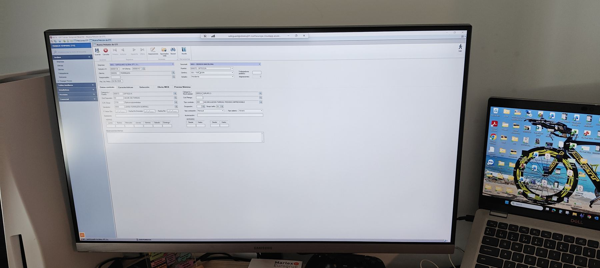

Captura de referencia: IMG20260626174020.jpg

| Campo / control visible | Tipo inferido | Observaciones |
|---|---|---|
| Empresa / sucursal / petición nº / nº oferta | Selector + código | Cabecera. |
| Cliente / centro / puesto | Código + selector | Datos del pedido. |
| Responsable / estado / fecha inicio petición | Texto + selector + fecha | Gestión de la petición. |
| Trabajadores pedidos / asignaciones | Numérico | Contadores. |
| Categoría / nivel salarial / código página | Código + búsqueda | Clasificación. |
| Tipo contrato / ocupación / grupo tarifa | Selector + búsqueda | Contrato y ocupación. |
| Tipo cotización / tipo salario | Selector | Parámetros laborales. |
| Autorización | Texto | Campo libre. |
| Horario semanal | Tabla de días | Lunes a domingo. |
| Horario desde/hasta | Hora | Tramos horarios. |
| Observaciones internas | Área de texto | Notas. |

## 16. Nueva Petición ETT — Características / Selección

Pestañas de características y selección, con selector de característica y tabla de valores.

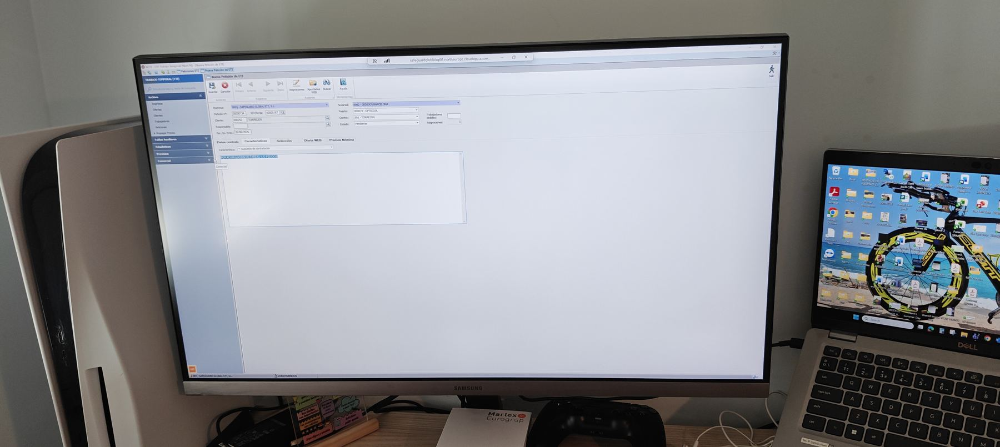

Captura de referencia: IMG20260626174118.jpg

| Campo / control visible | Tipo inferido | Observaciones |
|---|---|---|
| Característica | Selector desplegable | Pestaña Características. |
| Tabla de características/valores | Tabla | Área grande sin registros visibles o con una línea seleccionada. |
| Selección | Pestaña | En algunas capturas aparece vacía o sin datos legibles. |

## 17. Nueva Petición ETT — Oferta WEB

Publicación web de la petición/oferta, con textos de descripción y contacto.

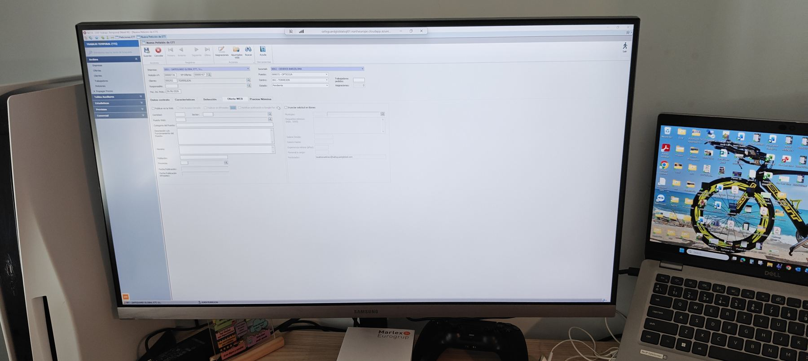

Captura de referencia: IMG20260626174214.jpg

| Campo / control visible | Tipo inferido | Observaciones |
|---|---|---|
| Publicar en la web | Checkbox | Control de publicación. |
| Opciones de publicación/estado | Radio / checkbox | Texto parcialmente legible. |
| Contacto / fecha | Texto + fecha | Contacto de publicación. |
| Puesto web | Texto | Título público. |
| Categoría oferta web | Selector | Clasificación pública. |
| Descripción de funciones | Área de texto | Texto de la oferta. |
| Horario / requisitos | Área de texto | Detalle público. |
| Población | Selector + búsqueda | Ubicación. |
| Fecha publicación / fecha fin publicación | Fecha | Vigencia web. |
| Datos de salario/condiciones | Campos importe/texto | Panel derecho parcialmente legible. |
| E-mail contacto | E-mail | Contacto público. |

## 18. Nueva Petición ETT — Precios Nómina

Tabla de precios de nómina asociada a la petición.

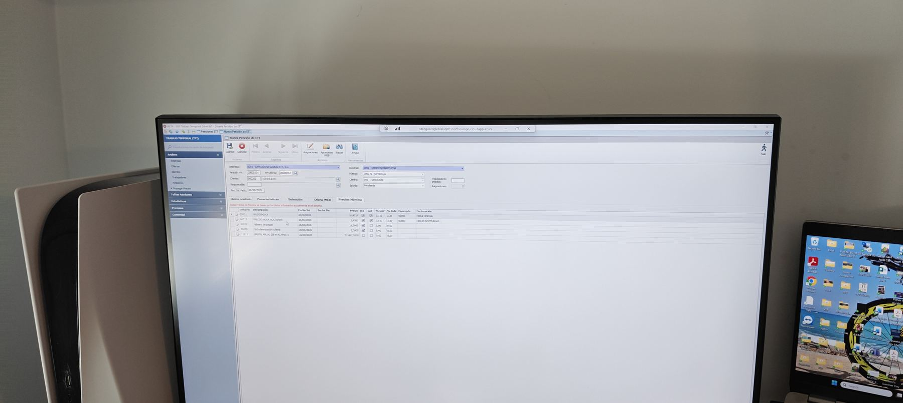

Captura de referencia: IMG20260626174226.jpg

| Campo / control visible | Tipo inferido | Observaciones |
|---|---|---|
| Concepto / descripción | Tabla | Líneas de concepto salarial. |
| Fecha inicio / fecha fin | Fecha | Vigencia. |
| Precio / pagas / indicadores | Importe + checkbox | Parámetros visibles de precio. |
| Referencia / observaciones | Texto | Columnas finales parcialmente legibles. |

## 19. Asignaciones de Peticiones de ETT

Pantalla para asignar candidatos/trabajadores a una petición y registrar aceptación/rechazo.

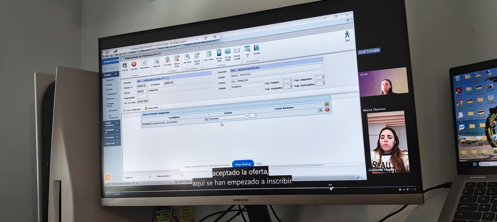

Captura de referencia: IMG20260626175114.jpg

| Campo / control visible | Tipo inferido | Observaciones |
|---|---|---|
| Empresa / petición nº / nº oferta / cliente / responsable / fecha inicio petición | Código + fecha | Cabecera. |
| Sucursal / puesto / centro / estado | Selector | Cabecera de asignación. |
| Trabajadores pedidos / asignados / aceptados / rechazados | Numérico | Contadores. |
| Nueva asignación | Acción | Añade línea. |
| Candidato | Código + búsqueda | Persona asignada. |
| Estado | Selector | Ej. aceptada. |
| Causa rechazo | Código + búsqueda | Motivo de rechazo. |
| Tabla asignaciones | Tabla | Origen, candidato, trabajador, nombre, estado asignación, fecha estado, causa rechazo, teléfono. |
| Acciones de comunicación | Botones | Doc. anex, enviar SMS, enviar notificación, enviar e-mail. |

## 20. Candidatos — Búsqueda/Listado

Listado maestro de candidatos/trabajadores con filtros de disponibilidad, CV y origen.

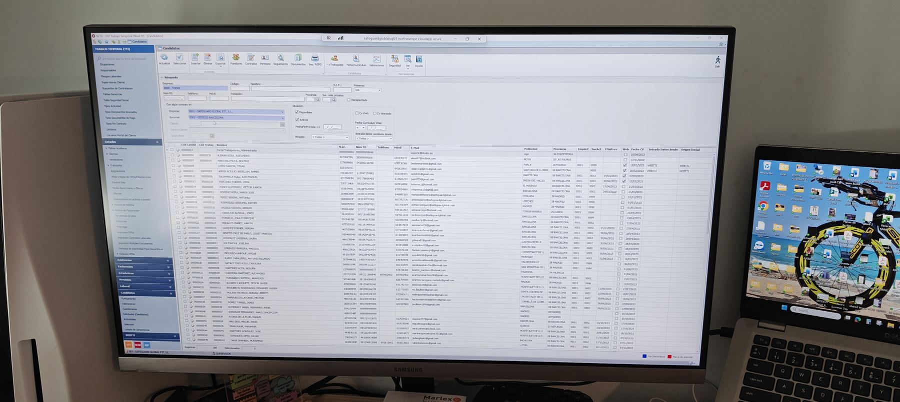

Captura de referencia: IMG20260626174406.jpg

| Campo / control visible | Tipo inferido | Observaciones |
|---|---|---|
| Empresa / sucursal / cliente / centro | Selector | Filtro por contexto. |
| Código / nombre / N.I.F. / primeros | Texto / selector | Búsqueda rápida. |
| Nº SS / teléfono / móvil / población / provincia | Texto + búsqueda | Datos de contacto y ubicación. |
| Situación: disponibles / activos | Checkbox | Disponibilidad. |
| Fecha fin prevista <= | Fecha | Filtro temporal. |
| CV web / CV anexado | Checkbox | Documentación CV. |
| Fecha currículum vitae | Fecha | Actualización CV. |
| Entrada datos candidato desde | Selector | Origen de datos. |
| Tabla de candidatos | Tabla | Código candidato, código trabajador, nombre, NIF, nº SS, teléfono, móvil, e-mail, población, provincia, empresa/sucursal actual, fechas, web, origen inicial. |
| Acciones | Botones | Familiares, contratos, permisos, seguimiento, documentos, imprimir RGPD, ficha/currículum, valoraciones, seguridad. |

## 21. Documento impreso/PDF de oferta o contrato

Vista de documento generado en PDF/visor con condiciones de puesto y texto contractual.

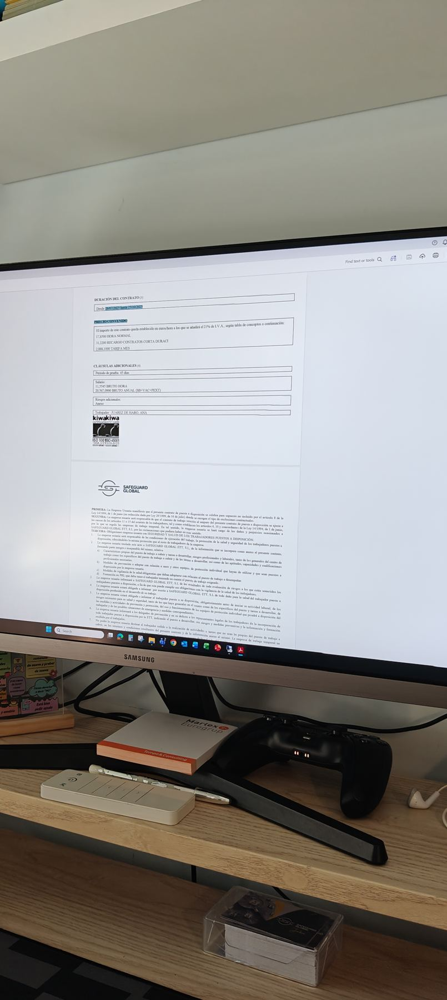

Captura de referencia: IMG20260626175441.jpg

| Campo / control visible | Tipo inferido | Observaciones |
|---|---|---|
| Duración del contrato | Texto / fecha | Rango de fechas visible. |
| Precio/convenio | Bloque de texto | Importes, hora normal, recargo y tarifa mes. |
| Cláusulas adicionales | Bloque de texto | Periodicidad pagas, salario, riesgos adicionales, trabajador. |
| Características del puesto de trabajo | Bloque de texto | Funciones, requisitos, horario/condiciones. |
| Logo/imagen de empresa | Imagen | Marca corporativa. |
| Texto legal / condiciones | Texto largo | Clausulado contractual. |

## Glosario de tipos inferidos

| Campo / control visible | Tipo inferido | Observaciones |
|---|---|---|
| Texto | Campo alfanumérico | Entrada libre. |
| Código + búsqueda | Campo codificado con lupa/lista | Selecciona registro maestro. |
| Selector | Desplegable | Lista cerrada de valores. |
| Checkbox | Booleano | Sí/no o marca múltiple. |
| Radio | Opción excluyente | Una selección entre varias. |
| Fecha / hora | Fecha u hora | Campos con formato dd/mm/aaaa o hh:mm. |
| Importe / porcentaje / decimal | Numérico | Cálculos económicos o laborales. |
| Tabla | Grid/listado | Filas con columnas, normalmente editable o seleccionable. |
| Área de texto | Texto multilínea | Observaciones/descripciones. |
| Contraseña | Campo protegido | Entrada enmascarada. |

Limitaciones: varias fotografías están tomadas en ángulo, con desenfoque o con ventanas superpuestas. Cuando el texto no es fiable se ha documentado el control funcional sin inventar valores concretos.

## Anexo — Capturas revisadas

Relación de las 47 fotografías procesadas y la pantalla o grupo funcional al que se han asociado. Una foto aparece marcada como no útil porque no contiene una pantalla de la aplicación.

| Fichero | Pantalla / grupo | Uso en documento |
|---|---|---|
| IMG20260626173235.jpg | Empresa de nómina — Dirección | Representativa |
| IMG20260626173243.jpg | Cliente — Identificación | Representativa |
| IMG20260626173246.jpg | Cliente — Facturación | Representativa |
| IMG20260626173250.jpg | Cliente — Firma Digital/Web | Representativa |
| IMG20260626173319.jpg | Cliente — Facturación | Representativa |
| IMG20260626173320.jpg | Cliente — Firma Digital/Web | Representativa |
| IMG20260626173328.jpg | Cliente — Centros | Representativa |
| IMG20260626173351.jpg | Cliente — Centros | Representativa |
| IMG20260626173417.jpg | Cliente — Contactos/listado | Representativa |
| IMG20260626173420.jpg | Cliente — Contactos/ficha | Representativa |
| IMG20260626173441.jpg | Usuario Portal del Cliente | Representativa |
| IMG20260626173515.jpg | Oferta — Datos Oferta con ventana superpuesta | Representativa |
| IMG20260626173519.jpg | Oferta — Datos Oferta | Representativa |
| IMG20260626173535.jpg | Oferta — Datos Oferta cumplimentada | Representativa |
| IMG20260626173541.jpg | Tabla auxiliar — Tipos de Contrato | Representativa |
| IMG20260626173559.jpg | Oferta — Datos de Cálculo | Representativa |
| IMG20260626173624.jpg | Oferta — Detalles | Representativa |
| IMG20260626173633.jpg | Tabla auxiliar — Categorías TTI-SRV | Representativa |
| IMG20260626173639.jpg | Oferta/Petición — vista de listado parcial | Representativa |
| IMG20260626173715.jpg | Oferta — Detalles cumplimentados | Representativa |
| IMG20260626173731.jpg | Tabla auxiliar/listado de contratos o categorías | Representativa |
| IMG20260626173813.jpg | Oferta — líneas de precio | Representativa |
| IMG20260626173821.jpg | Documento/hoja externa de apoyo | Representativa |
| IMG20260626173920.jpg | Ofertas — listado + modal | Representativa |
| IMG20260626173923.jpg | Ofertas — listado + modal | Representativa |
| IMG20260626173935.jpg | Peticiones ETT — consulta/listado | Representativa |
| IMG20260626173951.jpg | Ofertas — aceptar/generar petición | Representativa |
| IMG20260626173959.jpg | Ofertas/Peticiones — listado | Representativa |
| IMG20260626174014.jpg | Nueva Petición ETT — Datos contrato | Representativa |
| IMG20260626174020.jpg | Nueva Petición ETT — Datos contrato | Representativa |
| IMG20260626174112.jpg | Nueva Petición ETT — Datos contrato | Representativa |
| IMG20260626174118.jpg | Nueva Petición ETT — Características | Representativa |
| IMG20260626174138.jpg | Nueva Petición ETT — Selección | Representativa |
| IMG20260626174140.jpg | Nueva Petición ETT — Selección | Representativa |
| IMG20260626174156.jpg | Nueva Petición ETT — Selección/tabla vacía | Representativa |
| IMG20260626174214.jpg | Nueva Petición ETT — Oferta WEB | Representativa |
| IMG20260626174226.jpg | Nueva Petición ETT — Precios Nómina | Representativa |
| IMG20260626174254.jpg | Asignaciones de Peticiones ETT | Representativa |
| IMG20260626174406.jpg | Candidatos — búsqueda/listado | Representativa |
| IMG20260626174431.jpg | Candidatos — búsqueda/listado | Representativa |
| IMG20260626174459.jpg | Asignaciones de Peticiones ETT | Representativa |
| IMG20260626174516.jpg | Foto no útil / suelo | Descartada |
| IMG20260626175050.jpg | Candidatos / flujo en videollamada | Representativa |
| IMG20260626175057.jpg | Candidatos — búsqueda/listado | Representativa |
| IMG20260626175114.jpg | Asignaciones — aceptación de candidato | Representativa |
| IMG20260626175420.jpg | Documento/PDF de oferta o contrato | Representativa |
| IMG20260626175441.jpg | Documento/PDF de oferta o contrato | Representativa |
